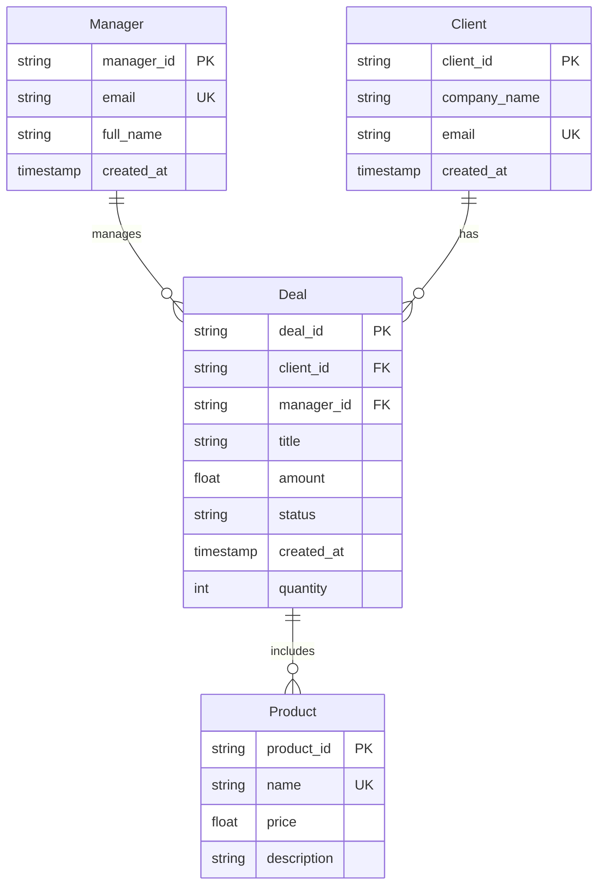

# Промпт 2 — Початкова генерація Mermaid erDiagram

**Задача для AI:** Згенерувати код Mermaid erDiagram на основі моєї специфікації `spec.md`.

**Промпт:**

> На основі наступної специфікації згенеруй код Mermaid erDiagram. Відобрази всі сутності, атрибути та зв'язки між ними з відповідними кардинальностями. Не додавай атрибутів, не зазначених у специфікації.
>
> ```markdown
> # Специфікація ER-моделі — B2B CRM
>
> ## Намір
> Спроєктувати концептуальну ER-модель для B2B CRM-системи, що фіксує роботу менеджерів із корпоративними клієнтами через угоди та каталог товарів. Модель відображає бізнес-логіку, а не фізичну схему БД.
>
> ## Сутності та атрибути
> - Manager: manager_id, email (унікальний), full_name, created_at.
> - Client: client_id, company_name, contact_email (унікальний), created_at.
> - Deal: deal_id, client_id (посилання на Client), manager_id (посилання на Manager), title, amount, status, created_at.
> - Product: product_id, name (унікальний), price, description (необов'язковий).
>
> ## Зв'язки
> 1. Manager → Deal (1 : 0..N)
> 2. Client → Deal (1 : 0..N)
> 3. Deal ↔ Product (M : N): одна угода включає щонайменше один товар (1..N); один товар може входити в нуль або багато угод (0..M). Зв'язок прямий, без сполучної сутності.
>
> ## Критерії прийняття
> 1. Артефакти: Mermaid erDiagram у model/er-diagram.mmd; візуальний рендер у model/er-diagram.png.
> 2. Концептуальна модель: бізнес-сутності та доменні зв'язки, не фізичні таблиці БД.
> 3. Зв'язки M:N моделюються як прямий зв'язок між сутностями без сполучних сутностей, якщо зв'язок не несе власних атрибутів.
> 4. Нормалізація (3NF).
> 5. Узгодженість найменувань.
> 6. Модель не містить атрибутів, не зазначених у специфікації.
> ```

**Відповідь AI:**

Ось код Mermaid erDiagram, згенерований за наданою специфікацією:


