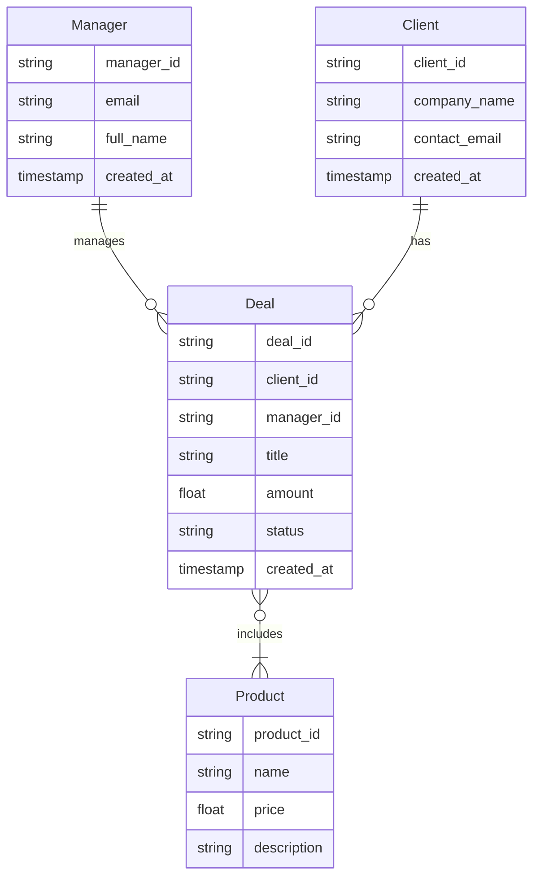

# Промпт 2 — Генерація Mermaid erDiagram

**Задача для AI:** Згенерувати код Mermaid erDiagram на основі специфікації.

**Промпт:**

> На основі наступної специфікації згенеруй код Mermaid erDiagram. Відобрази всі сутності, атрибути та зв'язки між ними з відповідними кардинальностями. Не додавай атрибутів, не зазначених у специфікації. Не вказуй PK, FK, UUIDv7 — це концептуальна модель.
>
> ```
> # Специфікація ER-моделі — B2B CRM
>
> ## Намір
> Спроєктувати концептуальну модель даних для B2B CRM-системи, яка фіксує роботу менеджерів із корпоративними клієнтами через угоди та каталог товарів. Модель показує бізнес-логіку: хто з ким працює, які угоди є та які товари входять в угоди. Модель не є фіційною схемою бази даних.
>
> ## Сутності та атрибути
> **Менеджер**: ідентифікатор менеджера, електронна пошта (унікальна), повне ім'я, дата створення.
> **Клієнт**: ідентифікатор клієнта, назва компанії, контактна електронна пошта (унікальна), дата створення.
> **Угода**: ідентифікатор угоди, посилання на клієнта, посилання на менеджера, назва угоди, сума угоди, статус, дата створення.
> **Товар**: ідентифікатор товару, назва товару (унікальна), ціна, опис (необов'язковий).
>
> ## Зв'язки
> 1. Менеджер → Угода (один до багатьох): один менеджер може вести нуль або багато угод; кожна угода належить рівно одному менеджеру.
> 2. Клієнт → Угода (один до багатьох): один клієнт може мати нуль або багато угод; кожна угода стосується рівно одного клієнта.
> 3. Угода ↔ Товар (багато до багатьох): одна угода включає щонайменше один товар; один товар може входити в нуль або багато угод. Зв'язок прямий, без додаткової сутності-посередника.
>
> ## Критерії прийняття
> 1. Артефакти: Mermaid erDiagram у model/er-diagram.mmd; візуальний рендер у model/er-diagram.png.
> 2. Концептуальна модель: лише бізнес-сутності та доменні зв'язки, не фізичні таблиці БД.
> 3. Зв'язок «багато до багатьох» моделюється як прямий зв'язок між сутностями, без сполучної таблиці, якщо сам зв'язок не несе своїх атрибутів.
> 4. Нормалізація (3NF): атрибути залежать лише від ідентифікатора своєї сутності.
> 5. Узгодженість найменувань у діаграмі зі spec.
> 6. Модель не містить атрибутів, яких немає у специфікації.
> ```

**Відповідь AI:**

Ось код Mermaid erDiagram, згенерований за наданою специфікацією:


