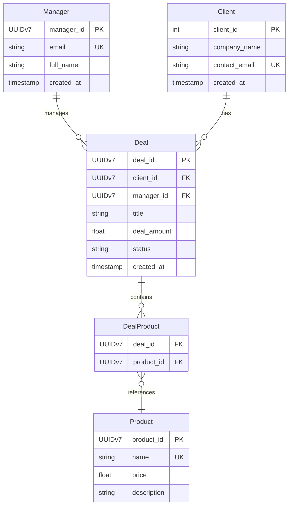

# Промпт 2 — Початкова генерація Mermaid erDiagram

**Задача для AI:** Згенерувати код Mermaid erDiagram на основі моєї специфікації `spec.md`.

**Промпт:**

> На основі наступної специфікації згенеруй код Mermaid erDiagram. Відобрази всі сутності, атрибути з типами та зв'язки між ними з відповідними кардинальностями.
>
> [вставлено текст spec.md версії v1]

**Відповідь AI:**

Ось код Mermaid erDiagram, згенерований за наданою специфікацією:

