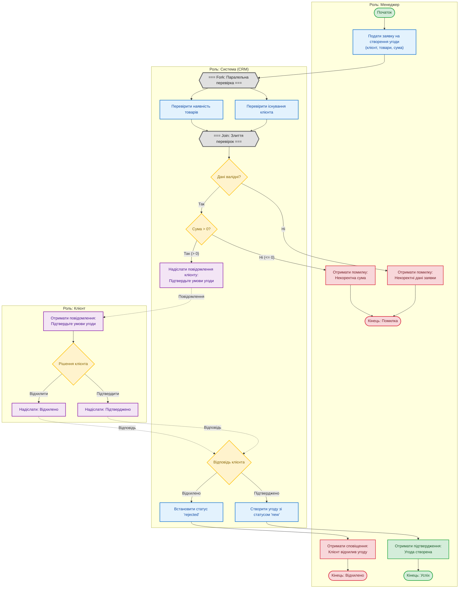
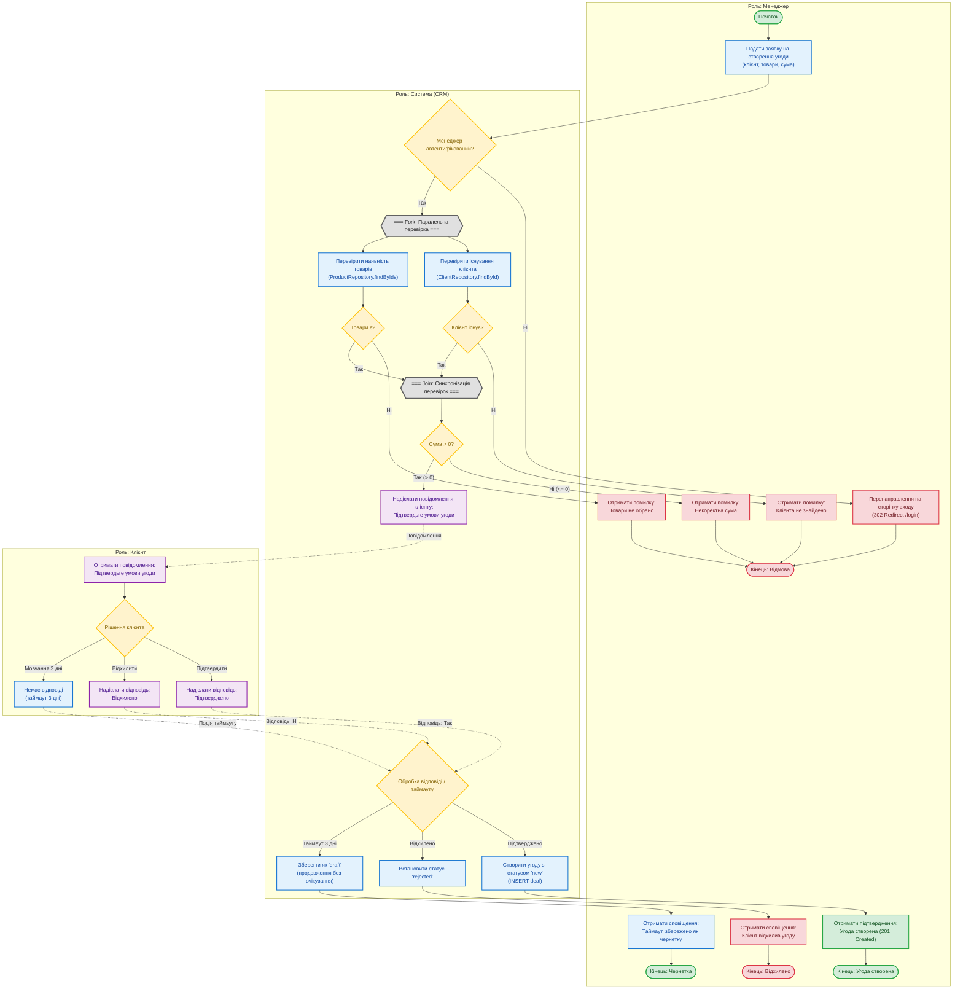

# Промпт 2 — Генерація Mermaid Activity-діаграми

**Задача для AI:** Згенерувати код Mermaid flowchart для Activity-діаграми за специфікацією.

**Промпт:**

> На основі моєї специфікації `spec.md` згенеруй декларативний код Activity-діаграми у синтаксисі Mermaid (`flowchart TD`). Використай `subgraph` для трьох доріжок ролей (Менеджер, Система (CRM), Клієнт), покажи паралельну гілку (`fork` / `join`), умовні розгалуження та обмін повідомленнями з клієнтом.
>
> ```markdown
# Специфікація процесу — B2B CRM (Лабораторна робота 4)

## 1. Обраний процес і зв'язок із попередніми моделями

Обрано бізнес-процес **«Створення комерційної угоди» (Create Deal)**, який деталізує прецедент `UC-3 Create Deal` із Лабораторної роботи №2 та спирається на взаємодію учасників із Лабораторної роботи №3 (`sequence-1-happy.mmd` – `sequence-5-unauthenticated.mmd`).

## 2. Обрана форма діаграми

Обрано **Activity-діаграму (Mermaid flowchart із доріжками ролей / swimlanes)**.

Чому обрано саме цю форму:
- Процес охоплює взаємодію трьох різних учасників (Менеджер, Система CRM, Клієнт), тому доріжки ролей дозволяють чітко розмежувати, хто виконує кожну дію.
- У процесі є одночасна перевірка клієнта та списку товарів, яку природно показати через вузли розгалуження й синхронізації паралельних потоків (`fork` / `join`).
- На відміну від машини станів (яка фокусується на станах одного об'єкта `Deal`), Activity-діаграма краще показує потік дій і передачу повідомлень між учасниками. На відміну від BPMN XML, текстовий Mermaid-опис легко переглядати у Git diff.

## 3. Ролі (учасники процесу)

1. **Менеджер (Manager)** — ініціює створення угоди, передає параметри заявки (клієнт, товари, сума) та отримує підсумкове сповіщення про результат.
2. **Система (CRM)** — перевіряє сесію, виконує паралельну валідацію клієнта й товарів, перевіряє суму угоди, надсилає клієнту запит на підтвердження умов і зберігає угоду.
3. **Клієнт (Client)** — отримує повідомлення від системи та приймає рішення (підтверджує умови, відхиляє їх або не відповідає у встановлений строк).

## 4. Кроки процесу

1. **Початок процесу:** Менеджер подає заявку на створення угоди (вказує `client_id`, перелік `product_ids` та суму `amount`).
2. **Перевірка автентифікації:** Система перевіряє, чи автентифікований менеджер (сценарій S5 із Lab 2/3). Якщо ні — перенаправляє на сторінку входу й завершує процес.
3. **Паралельна перевірка (fork/join):** Система одночасно запускає дві гілки:
   - перевірка існування клієнта в базі (`ClientRepository.findById`);
   - перевірка наявності обраних товарів (`ProductRepository.findByIds`).
4. **Перевірка результатів валідації даних:** Якщо клієнта не знайдено (S2) або список товарів порожній (S3) — система повертає відповідну помилку менеджеру і процес завершується.
5. **Перевірка суми угоди:** Система перевіряє умову `amount > 0` (S4). Якщо сума менша або дорівнює нулю — повертає помилку «Некоректна сума» і процес завершується.
6. **Надсилання повідомлення клієнту:** Система формує та надсилає клієнту повідомлення «Підтвердьте умови угоди».
7. **Очікування та обробка відповіді клієнта:**
   - **Клієнт підтвердив:** Система створює запис угоди зі статусом `new` (S1), повертає менеджеру підтвердження зі згенерованим `deal_id`, процес успішно завершується.
   - **Клієнт відхилив:** Система фіксує відмову (статус `rejected`), повідомляє менеджера про відхилення, процес завершується.
   - **Клієнт не відповів (таймаут 3 дні):** Система не блокує процес назавжди — після спливу таймера угода зберігається як чернетка (`draft`), менеджер отримує сповіщення про очікування, процес штатно завершується.

## 5. Розгалуження, паралельність та повідомлення

- **Умовні розгалуження (if/else):**
  1. Чи автентифікований менеджер? (так / ні)
  2. Чи існує клієнт? (так / ні)
  3. Чи обрано товари? (так / ні)
  4. Чи сума угоди > 0? (так / ні)
  5. Яка реакція клієнта на повідомлення? (підтверджено / відхилено / таймаут 3 дні)
- **Паралельна гілка (fork/join):** одночасне виконання перевірки клієнта та перевірки товарів після успішної автентифікації.
- **Повідомлення:**
  - *Хто надсилає:* Система (CRM).
  - *Хто приймає:* Клієнт.
  - *Зміст:* «Підтвердьте умови угоди».
  - *Що відбувається далі:* при підтвердженні створюється угода (`new`), при відмові — скасовується (`rejected`), при відсутності відповіді протягом 3 днів — процес продовжується без подальшого очікування і зберігає чернетку (`draft`).

## 6. Критерії прийняття

1. Артефакти: декларативний опис у `model/activity-diagram.mmd` та рендер у `model/activity-diagram.png`.
2. Використано рівно одну нотацію (Activity-діаграма з доріжками ролей Менеджер, Система, Клієнт).
3. Усі стани й дії досяжні, кожна гілка має чіткий перехід до кінцевого вузла (немає «дір» чи висячих вузлів).
4. Присутні щонайменше одне розгалуження, одна паралельна гілка (`fork/join`) та одне надсилання повідомлення між учасниками.
> ```

**Відповідь AI:**

Ось код Mermaid flowchart для процесу створення угоди:



---

## Повторна генерація після уточнення критеріїв 5–7 у spec.md

**Промпт:**

> Онови Activity-діаграму за доповненою специфікацією `spec.md` (з урахуванням критеріїв 5, 6, 7):
> 1. Додай третю гілку реакції на повідомлення клієнту — подію таймауту (3 дні без відповіді) зі збереженням чернетки `draft` і сповіщенням менеджера.
> 2. Додай ромб перевірки автентифікації `Менеджер автентифікований?` перед `Fork` із переходом на `302 Redirect /login` (сценарій S5).
> 3. Розділи перевірки в паралельних гілках: окремий ромб `Клієнт існує?` (помилка «Клієнта не знайдено») та окремий ромб `Товари є?` (помилка «Товари не обрано»), щоб у `Join` сходилися лише успішні гілки.
>
> ```markdown
# Специфікація процесу — B2B CRM (Лабораторна робота 4)

## 1. Обраний процес і зв'язок із попередніми моделями

Обрано бізнес-процес **«Створення комерційної угоди» (Create Deal)**, який деталізує прецедент `UC-3 Create Deal` із Лабораторної роботи №2 та спирається на взаємодію учасників із Лабораторної роботи №3 (`sequence-1-happy.mmd` – `sequence-5-unauthenticated.mmd`).

## 2. Обрана форма діаграми

Обрано **Activity-діаграму (Mermaid flowchart із доріжками ролей / swimlanes)**.

Чому обрано саме цю форму:
- Процес охоплює взаємодію трьох різних учасників (Менеджер, Система CRM, Клієнт), тому доріжки ролей дозволяють чітко розмежувати, хто виконує кожну дію.
- У процесі є одночасна перевірка клієнта та списку товарів, яку природно показати через вузли розгалуження й синхронізації паралельних потоків (`fork` / `join`).
- На відміну від машини станів (яка фокусується на станах одного об'єкта `Deal`), Activity-діаграма краще показує потік дій і передачу повідомлень між учасниками. На відміну від BPMN XML, текстовий Mermaid-опис легко переглядати у Git diff.

## 3. Ролі (учасники процесу)

1. **Менеджер (Manager)** — ініціює створення угоди, передає параметри заявки (клієнт, товари, сума) та отримує підсумкове сповіщення про результат.
2. **Система (CRM)** — перевіряє сесію, виконує паралельну валідацію клієнта й товарів, перевіряє суму угоди, надсилає клієнту запит на підтвердження умов і зберігає угоду.
3. **Клієнт (Client)** — отримує повідомлення від системи та приймає рішення (підтверджує умови, відхиляє їх або не відповідає у встановлений строк).

## 4. Кроки процесу

1. **Початок процесу:** Менеджер подає заявку на створення угоди (вказує `client_id`, перелік `product_ids` та суму `amount`).
2. **Перевірка автентифікації:** Система перевіряє, чи автентифікований менеджер (сценарій S5 із Lab 2/3). Якщо ні — перенаправляє на сторінку входу й завершує процес.
3. **Паралельна перевірка (fork/join):** Система одночасно запускає дві гілки:
   - перевірка існування клієнта в базі (`ClientRepository.findById`);
   - перевірка наявності обраних товарів (`ProductRepository.findByIds`).
4. **Перевірка результатів валідації даних:** Якщо клієнта не знайдено (S2) або список товарів порожній (S3) — система повертає відповідну помилку менеджеру і процес завершується.
5. **Перевірка суми угоди:** Система перевіряє умову `amount > 0` (S4). Якщо сума менша або дорівнює нулю — повертає помилку «Некоректна сума» і процес завершується.
6. **Надсилання повідомлення клієнту:** Система формує та надсилає клієнту повідомлення «Підтвердьте умови угоди».
7. **Очікування та обробка відповіді клієнта:**
   - **Клієнт підтвердив:** Система створює запис угоди зі статусом `new` (S1), повертає менеджеру підтвердження зі згенерованим `deal_id`, процес успішно завершується.
   - **Клієнт відхилив:** Система фіксує відмову (статус `rejected`), повідомляє менеджера про відхилення, процес завершується.
   - **Клієнт не відповів (таймаут 3 дні):** Система не блокує процес назавжди — після спливу таймера угода зберігається як чернетка (`draft`), менеджер отримує сповіщення про очікування, процес штатно завершується.

## 5. Розгалуження, паралельність та повідомлення

- **Умовні розгалуження (if/else):**
  1. Чи автентифікований менеджер? (так / ні)
  2. Чи існує клієнт? (так / ні)
  3. Чи обрано товари? (так / ні)
  4. Чи сума угоди > 0? (так / ні)
  5. Яка реакція клієнта на повідомлення? (підтверджено / відхилено / таймаут 3 дні)
- **Паралельна гілка (fork/join):** одночасне виконання перевірки клієнта та перевірки товарів після успішної автентифікації.
- **Повідомлення:**
  - *Хто надсилає:* Система (CRM).
  - *Хто приймає:* Клієнт.
  - *Зміст:* «Підтвердьте умови угоди».
  - *Що відбувається далі:* при підтвердженні створюється угода (`new`), при відмові — скасовується (`rejected`), при відсутності відповіді протягом 3 днів — процес продовжується без подальшого очікування і зберігає чернетку (`draft`).

## 6. Критерії прийняття

1. Артефакти: декларативний опис у `model/activity-diagram.mmd` та рендер у `model/activity-diagram.png`.
2. Використано рівно одну нотацію (Activity-діаграма з доріжками ролей Менеджер, Система, Клієнт).
3. Усі стани й дії досяжні, кожна гілка має чіткий перехід до кінцевого вузла (немає «дір» чи висячих вузлів).
4. Присутні щонайменше одне розгалуження, одна паралельна гілка (`fork/join`) та одне надсилання повідомлення між учасниками.
5. Для повідомлення клієнту обов'язково моделюються всі три гілки реакції: підтвердження (`new`), відмова (`rejected`) та відсутність відповіді протягом 3 днів (подія таймауту з переходом у статус `draft` без блокування процесу).6. Перед запуском паралельної перевірки (`fork`) обов'язково виконується перевірка автентифікації менеджера (`AuthCond`) з перенаправленням на `/login` у разі відмови (узгодження зі сценарієм S5 із Lab 2 та Lab 3).7. Кожна паралельна гілка валідації перевіряє свою умову окремо (`Клієнт існує?` та `Товари є?`) і повертає власне повідомлення про помилку («Клієнта не знайдено» за S2 або «Товари не обрано» за S3); у вузол `Join` сходяться лише успішні гілки.
> ```

**Відповідь AI (оновлена модель):**


